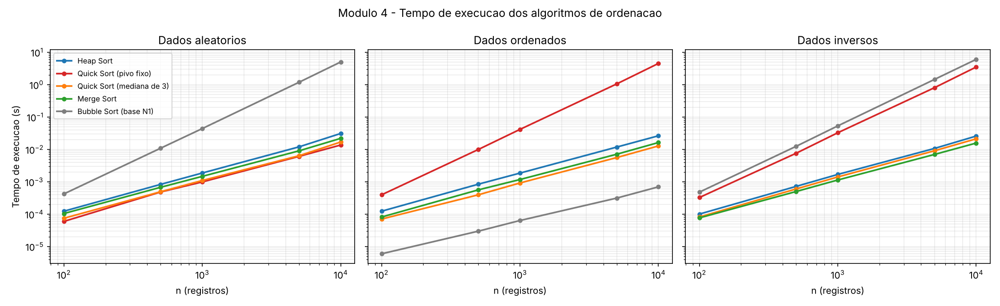
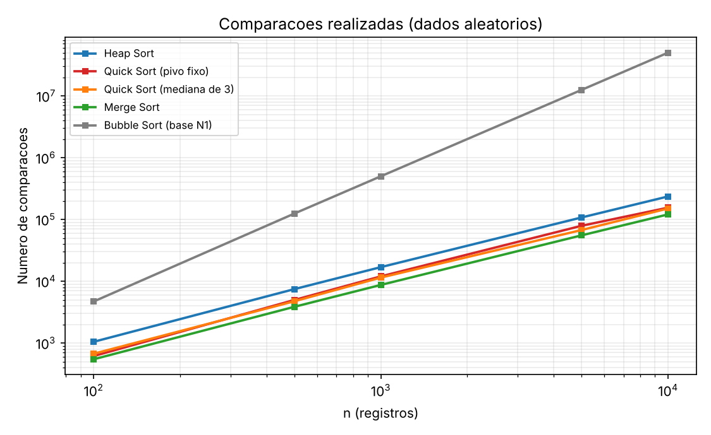
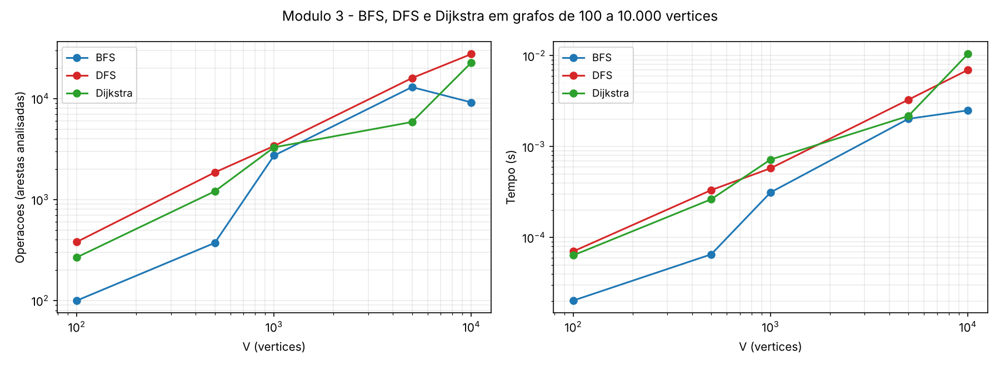
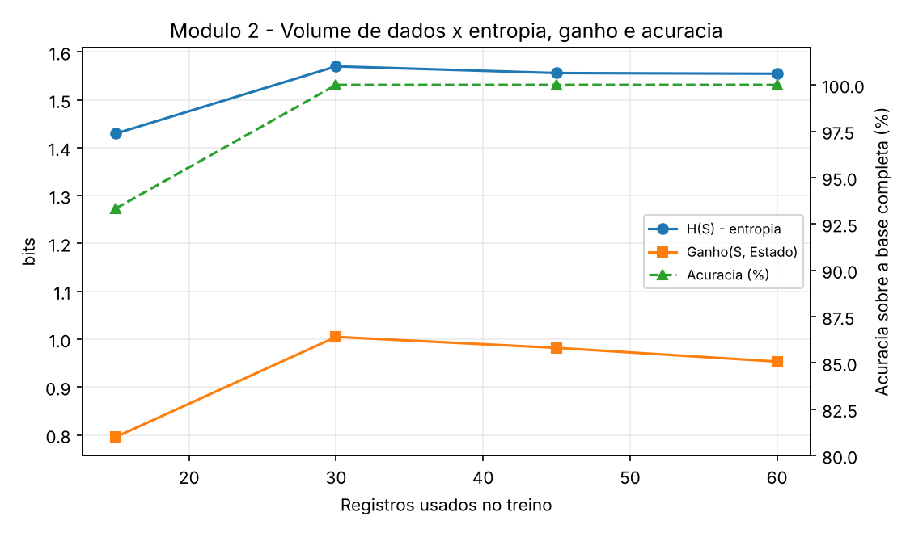

# Relatorio tecnico - resultados experimentais

Gerado automaticamente por `experimentos/resultados.py`.

## 1. Ordenacao (Modulo 4)

Tempo em segundos, mesma massa de dados para todos os algoritmos.

| Cenario | Algoritmo | Tempo (s) | Comparacoes | Movimentacoes |
|---|---|---|---|---|
| aleatorio | Heap Sort | 0.031189 | 235163 | 124150 |
| aleatorio | Quick Sort (pivo fixo) | 0.013712 | 154959 | 82701 |
| aleatorio | Quick Sort (mediana de 3) | 0.016981 | 150170 | 72146 |
| aleatorio | Merge Sort | 0.022025 | 120485 | 133616 |
| aleatorio | Bubble Sort (base N1) | 5.043063 | 49994847 | 25050317 |
| ordenado | Heap Sort | 0.02645 | 244512 | 131777 |
| ordenado | Quick Sort (pivo fixo) | 4.538385 | 49995000 | 50004999 |
| ordenado | Quick Sort (mediana de 3) | 0.012858 | 131347 | 66449 |
| ordenado | Merge Sort | 0.016365 | 69008 | 133616 |
| ordenado | Bubble Sort (base N1) | 0.000701 | 9999 | 0 |
| inverso | Heap Sort | 0.025928 | 226701 | 116709 |
| inverso | Quick Sort (pivo fixo) | 3.514897 | 49792908 | 24907744 |
| inverso | Quick Sort (mediana de 3) | 0.0213 | 241933 | 144179 |
| inverso | Merge Sort | 0.015751 | 64630 | 133616 |
| inverso | Bubble Sort (base N1) | 6.061632 | 49995000 | 49994959 |

## 2. Busca em grafos (Modulo 3)

| Algoritmo | Caminho CPD -> SalaReunioes | Arestas | Custo | Visitados | Operacoes |
|---|---|---|---|---|---|
| BFS | CPD -> Diretoria -> SalaReunioes | 2 | 16 | 12 | 26 |
| DFS | CPD -> Administrativo -> Financeiro -> SalaReunioes | 3 | 13 | 5 | 13 |
| Dijkstra | CPD -> Administrativo -> Financeiro -> Diretoria -> SalaReunioes | 4 | 12 | 12 | 31 |

## 3. Classificacao ID3 (Modulo 2)

| Registros | H(S) | Ganho(Estado) | Nos | Folhas | Profundidade | Acuracia |
|---|---|---|---|---|---|---|
| 15 | 1.4295 | 0.7955 | 10 | 7 | 3 | 0.9333 |
| 30 | 1.57 | 1.0048 | 13 | 9 | 4 | 1.0 |
| 45 | 1.556 | 0.9819 | 12 | 8 | 4 | 1.0 |
| 60 | 1.5546 | 0.9533 | 13 | 9 | 4 | 1.0 |
| treino(42) | 1.5751 | 0.9226 | 13 | 9 | 4 | 1.0 |

